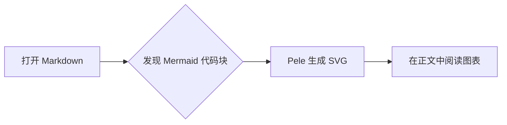
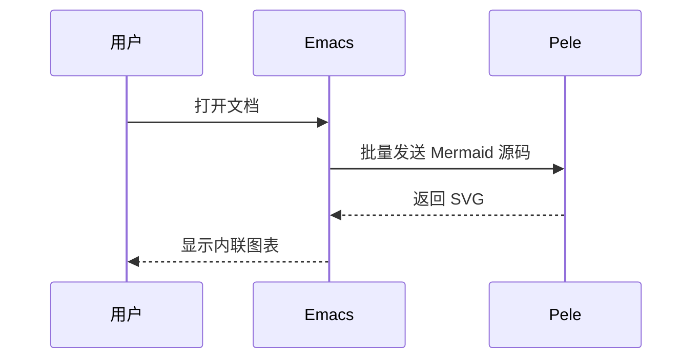
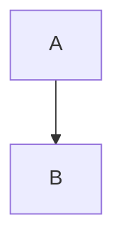

# Markdown 阅读示例

Mermaid 图表会直接显示在正文中。将光标移到图表上，按 **C-c C-x m** 查看源码，再按一次返回图形。

## 从文档到图形



正文和图表保存在同一份 Markdown 中，复制、保存时仍然使用原始文本。

## 阅读与修改



- **C-c C-x m**：切换当前图表的源码与图片。
- **C-c C-x M**：切换整篇文档的图表。
- **C-c C-x r**：刷新图表；加 **C-u** 可清除缓存并重试。
- **M-x frei/markdown-mermaid-mode**：开启或关闭 Mermaid 显示。

## 文档中的代码示例

下面的围栏包含一个 Markdown 代码示例，其中的 Mermaid 保持为文本：

````markdown

````
